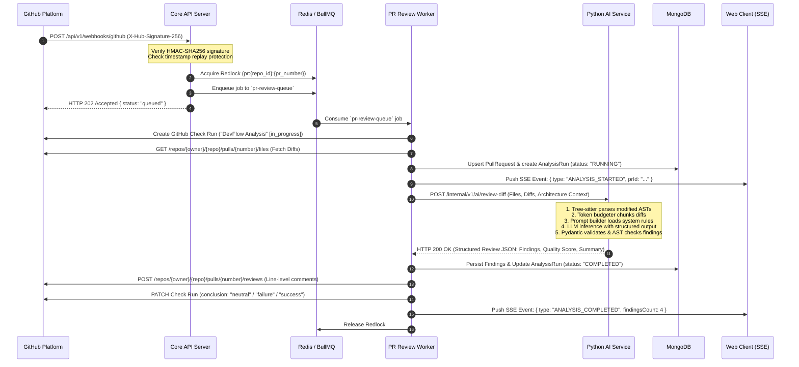
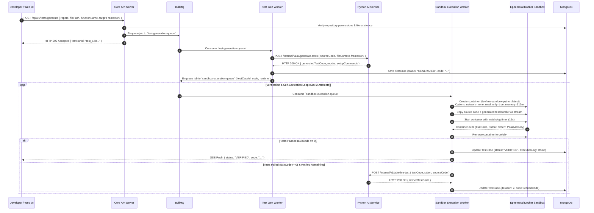

# DevFlow AI — System Architecture Specification

## 1. Architectural Philosophy & Design Principles

DevFlow AI is designed as a **Modular Monolith with Decoupled Compute Microservices**. This hybrid pattern provides maximum engineering velocity, single-database transactional consistency, and simplified operations, while strictly isolating CPU-bound, memory-intensive, and security-critical execution workloads into specialized, independently scalable microservices.

```
+===================================================================================================+
|                                        DEVFLOW AI TOPOLOGY                                        |
+===================================================================================================+
                                            
                                       CLIENT / CDN
                                   [ Vercel Edge CDN ]
                                            |
                                            | HTTPS / WSS
                                            v
+---------------------------------------------------------------------------------------------------+
| INGRESS & API GATEWAY LAYER                                                                       |
|   Reverse Proxy (NGINX / AWS ALB) -> TLS Termination, Rate Limiting, Correlation ID Injection     |
+---------------------------------------------------------------------------------------------------+
                                            |
                    +-----------------------+-----------------------+
                    |                                               |
                    v                                               v
+---------------------------------------+       +---------------------------------------+
| CORE API MONOLITH (Node.js/Express)   |       | PYTHON AI ENGINE (FastAPI)            |
| - Authentication & RBAC (JWT/OAuth)   |       | - Tree-sitter AST Parser Engine       |
| - GitHub Webhook & App Dispatcher     |       | - Context Aggregator & Chunker        |
| - REST API Endpoints & Zod Validation |<----->| - LLM Prompt Orchestrator & Fallbacks |
| - Mongoose Repositories & Business    |  mTLS | - Strict Pydantic JSON Schema Parser  |
| - BullMQ Job Producers                |       | - Hallucination AST Validator         |
+---------------------------------------+       +---------------------------------------+
          |                      |
          | Read / Write         | Enqueue Work
          v                      v
+-------------------+  +----------------------------------------------------------------------------+
| PRIMARY DATABASE  |  | REDIS 7.2 INFRASTRUCTURE LAYER                                             |
| MongoDB 7.0 (RS)  |  | - BullMQ Distributed Message Queues (At-least-once Delivery)               |
| - ACID Sessions   |  | - Distributed Locks (Redlock) for Ingestion Deduplication                  |
| - Compound Indexes|  | - Token Bucket Rate Limiting & User WebSockets Pub/Sub                     |
| - Change Streams  |  +----------------------------------------------------------------------------+
+-------------------+                                    |
                                                         | Pull Jobs
                                                         v
                       +----------------------------------------------------------------------------+
                       | DISTRIBUTED WORKER FLEET                                                   |
                       +----------------------------------------------------------------------------+
                       | [ Worker Node A: Webhook & Ingestion Processors ]                          |
                       | [ Worker Node B: PR Review & Analysis Processors ]                         |
                       | [ Worker Node C: Sandbox Execution Controller ]                            |
                       +----------------------------------------------------------------------------+
                                                         |
                                                         | Docker API / Unix Socket
                                                         v
                               +----------------------------------------------------+
                               | EPHEMERAL SECURE EXECUTION SANDBOX                 |
                               | - Docker Engine / gVisor (runsc) Runtime           |
                               | - Zero Network Egress (`--network none`)           |
                               | - Read-Only Root Filesystem & Memory tmpfs         |
                               | - Non-root Unprivileged User (UID:GID 10001:10001) |
                               | - Strict cgroups v2 Limits (512MB RAM, 1.0 vCPU)   |
                               | - Whitelisted Syscalls Seccomp Security Profile    |
                               +----------------------------------------------------+
```

### Key Architectural Tenets:
1. **Separation of I/O Bound vs. AI/AST Compute Bound Work**:
   - Node.js handles massive concurrent I/O: webhooks, client connections, database access, and queue orchestration.
   - Python processes AST generation, vector operations, token budgeting, and LLM communication via native C-bindings and async ASGI pipelines.
2. **Deterministic, Untrusted Code Isolation**:
   - User code and generated unit tests are **never executed directly on the host machine or application containers**.
   - Every execution run spins up an ephemeral, throwaway container with absolute network lockdown (`--network none`), strict resource quotas, and stripped Linux capabilities.
3. **Strict Structured Output Contracts**:
   - Raw free-form LLM outputs are never ingested directly into the database. All AI inference responses are bound to strict JSON schemas validated via Pydantic v2 and Zod before persisting.
4. **Resilient Asynchronous Pipelines**:
   - Long-running tasks (scans, multi-file PR reviews, test execution loops) are offloaded to BullMQ background workers with exponential backoff, dead-letter queues, and atomic deduplication locks.

---

## 2. Service Responsibilities & Component Architecture

### 2.1. Frontend Web Client (`apps/web`)
- **Technology**: React 18, TypeScript, Vite, Tailwind CSS, shadcn/ui (Radix Primitives), TanStack Query v5, React Router v6.
- **Role**: High-performance Single Page Application (SPA).
- **Core Capabilities**:
  - OAuth login and organization/workspace onboarding.
  - Interactive repository browser and file tree viewer.
  - Real-time scan and analysis progression monitoring via Server-Sent Events (SSE).
  - Code review diff viewer with syntax-highlighted inline vulnerability markers.
  - Interactive test generator studio with one-click sandbox execution and real-time execution console logs.
  - Repository health dashboard displaying cyclomatic complexity, CWE distributions, and technical debt trends.

### 2.2. Core API Monolith (`apps/api`)
- **Technology**: Node.js 20 LTS, Express.js, TypeScript, Zod, Mongoose, BullMQ.
- **Role**: Central coordinator, API Gateway, and state orchestrator.
- **Core Capabilities**:
  - **Authentication & RBAC**: JWT access/refresh token handling, GitHub OAuth token exchange, role-based authorization (Owner, Admin, Member, Viewer).
  - **GitHub App Gateway**: Webhook verification (`X-Hub-Signature-256`), GitHub REST API client management via `@octokit/rest`, dynamic installation token rotation.
  - **Input Validation**: Request body, query, and parameter schema enforcement using Zod.
  - **Job Orchestration**: Enqueueing analysis, review, and execution tasks to Redis/BullMQ.
  - **Real-time Event Bridge**: SSE endpoint for pushing live scan updates and test run logs to connected web clients.

### 2.3. Python AI Intelligence Service (`services/ai`)
- **Technology**: Python 3.11, FastAPI, Pydantic v2, Tree-sitter, Uvicorn.
- **Role**: High-throughput language modeling and AST analysis microservice.
- **Core Capabilities**:
  - **AST Parsing Engine**: Tree-sitter parsers for Python, JavaScript, and TypeScript to extract functions, classes, import graphs, and cyclomatic complexity metrics.
  - **Prompt Orchestration**: Context window optimizer with token budgeting (tiktoken), sliding window diff chunking, and repository-level context assembly.
  - **LLM Provider Agnostic Gateway**: Unified interface supporting Anthropic Claude (Claude 3.5 Sonnet), OpenAI (GPT-4o), and local models via Ollama/vLLM.
  - **Structured Extraction**: Strict JSON output enforcement using Pydantic models. Guarantees deterministic schema compliance for code findings, CVE mappings, and test cases.
  - **Hallucination Verification**: Deterministic post-processing step checking that flagged line numbers and identifiers actually exist in the supplied source files.

### 2.4. Background Job Worker Fleet (`workers/job-processor`)
- **Technology**: Node.js 20, TypeScript, BullMQ, Mongoose, Octokit.
- **Role**: Scalable, horizontally distributed job consumer processes.
- **Queues Managed**:
  - `github-webhook-queue`: Ingests and routes incoming GitHub webhooks (`pull_request`, `push`, `installation`).
  - `repo-analysis-queue`: Manages full repository codebase analysis.
  - `pr-review-queue`: Fetches PR git diffs, orchestrates multi-file context, triggers AI review, and publishes GitHub Check Runs and review comments.
  - `test-generation-queue`: Dispatches test generation workflows to the Python AI service.

### 2.5. Isolated Execution Sandbox Engine (`workers/execution-engine`)
- **Technology**: Node.js 20, Dockerode / Docker Engine API, gVisor (`runsc`), Linux cgroups v2.
- **Role**: Executes untrusted user code and AI-generated unit tests in isolated, zero-privilege micro-containers.
- **Core Capabilities**:
  - Dynamic container lifecycle management (create, copy test bundle, run, capture stdout/stderr, inspect exit code, destroy).
  - Enforces hard execution timeouts, memory boundaries (512 MB), CPU pin quotas, and process limits (`pids.max = 64`).
  - Strict network isolation (`NetworkMode: "none"`).
  - Returns structured test execution results (pass/fail status, duration, stdout, stderr, stack traces).

---

## 3. Distributed Queue Topology & Processing Workflows

BullMQ backed by Redis 7.2 serves as the distributed message spine.

### Queue Architecture Specification

| Queue Name | Concurrency | Retry Strategy | Backoff Type | Dead Letter Queue (DLQ) |
| :--- | :--- | :--- | :--- | :--- |
| `webhook-ingestion-queue` | 20 per worker | 5 attempts | Exponential (2s, 4s, 8s, 16s, 32s) | `webhook-ingestion-dlq` |
| `repository-scan-queue` | 3 per worker | 3 attempts | Exponential (10s, 30s, 60s) | `repository-scan-dlq` |
| `pr-review-queue` | 10 per worker | 3 attempts | Exponential (5s, 15s, 45s) | `pr-review-dlq` |
| `test-generation-queue` | 5 per worker | 2 attempts | Fixed (5s) | `test-generation-dlq` |
| `sandbox-execution-queue`| 4 per worker | 1 attempt (No retry on user error)| None | `sandbox-execution-dlq` |
| `github-dispatch-queue` | 15 per worker | 4 attempts | Exponential (3s, 9s, 27s) | `github-dispatch-dlq` |

---

## 4. End-to-End Workflow & Data Flow Diagrams

### 4.1. Workflow 1: Pull Request Ingestion & Automated Review



---

### 4.2. Workflow 2: Test Generation with Sandboxed Verification Loop



---

### 4.3. Workflow 3: Full Repository Codebase Scan & Knowledge Indexing

```mermaid
sequenceDiagram
    autonumber
    participant Web as Web Dashboard
    participant API as Core API Server
    participant Redis as BullMQ
    participant ScanWorker as Repo Scan Worker
    participant GH as GitHub REST API
    participant PyAI as Python AI Service
    participant DB as MongoDB

    Web->>API: POST /api/v1/repositories/{id}/scans { branch: "main" }
    API->>DB: Create AnalysisRun (type: "FULL_SCAN", status: "PENDING")
    API->>Redis: Enqueue to `repository-scan-queue`
    API-->>Web: HTTP 202 Accepted { scanId: "scan_101" }

    Redis->>ScanWorker: Consume `repository-scan-queue`
    ScanWorker->>GH: Download repository archive tarball (HEAD of branch)
    ScanWorker->>ScanWorker: Extract code to ephemeral storage; filter binary/node_modules

    ScanWorker->>PyAI: POST /internal/v1/ai/parse-ast-batch (List of source files)
    Note over PyAI: Build dependency graph,<br/>extract function symbols, class hierarchies,<br/>compute Cyclomatic Complexity
    PyAI-->>ScanWorker: AST Metadata & File Complexity Index

    loop Batch Processing (Batches of 10 Related Files)
        ScanWorker->>PyAI: POST /internal/v1/ai/analyze-batch (AST, Code, Dependency Context)
        PyAI-->>ScanWorker: Vulnerabilities, Logic Smells, Tech Debt Metrics
        ScanWorker->>DB: Bulk insert Issues / Findings
        ScanWorker->>Web: SSE Push: Progress { completedFiles: 30, totalFiles: 100 }
    end

    ScanWorker->>DB: Update Repository Metrics (Health Score, Complexity, Debt Hours)
    ScanWorker->>DB: Finalize AnalysisRun (status: "COMPLETED", durationMs, tokenUsage)
    ScanWorker->>Web: SSE Push: Scan Completed { scanId: "scan_101", score: 88 }
```

---

## 5. Secure Code Execution Architecture

Executing arbitrary user code and AI-generated tests presents severe security vectors: Remote Code Execution (RCE), Denial of Service via fork bombs, host filesystem tampering, and Server-Side Request Forgery (SSRF).

DevFlow AI implements a **Seven-Tier Defense-in-Depth Isolation Stack**:

```
+-------------------------------------------------------------------------------+
|                       7-TIER EXECUTION SANDBOX ISOLATION                      |
+-------------------------------------------------------------------------------+
| Tier 1: Isolation Boundary        | 1 Ephemeral Docker Container per Run      |
| Tier 2: Network Lockdown          | NetworkMode: "none" (Zero Ingress/Egress) |
| Tier 3: Filesystem Protection     | Read-Only Root Filesystem + 64MB tmpfs    |
| Tier 4: User & Privilege Stripping| Non-root (UID 10001), All Caps Dropped    |
| Tier 5: Kernel Boundary (Seccomp) | Whitelist-only Syscalls, Blocks ptrace/raw|
| Tier 6: Resource Governance       | cgroups v2: 512MB RAM, 1 CPU, 64 PIDs max |
| Tier 7: Hardware Virtualization   | gVisor (runsc) Userspace Kernel Sandbox   |
+-------------------------------------------------------------------------------+
```

### Detailed Sandbox Specifications

1. **Ephemeral Lifecycle**:
   - Every execution run starts a fresh, non-reusable container from pre-baked base images (`devflow-sandbox-python`, `devflow-sandbox-node`).
   - The container is terminated and forcefully removed (`docker rm -f`) immediately upon completion or timeout. No state persists.
2. **Network Egress Blocked**:
   - Containers are initialized with `--network none`. No virtual ethernet interface (`veth`) is attached. Outbound connections to LAN, AWS metadata services (`169.254.169.254`), or the internet are physically impossible.
3. **Immutable Filesystem with Sandboxed Mount**:
   - The root filesystem (`/`) is mounted **read-only** (`--read-only=true`).
   - A single in-memory temporary directory (`/tmp`) is mounted as a `tmpfs` volume with options: `rw,noexec,nosuid,nodev,size=64m`.
   - The test code bundle is injected into an isolated workspace directory (`/workspace`) with write restrictions.
4. **Unprivileged Execution**:
   - Containers run under explicit non-root user and group (`--user 10001:10001`).
   - Every Linux capability is stripped at startup (`--cap-drop=ALL`). No privilege escalation can occur via setuid binaries.
5. **Syscall Filtering via Seccomp Profile**:
   - A custom strict Seccomp profile blocks dangerous syscalls: `ptrace`, `sys_chroot`, `clone` (without CLONE_THREAD), `reboot`, `mount`, `bpf`, `keyctl`.
6. **cgroups v2 Resource Governance**:
   - **Memory Quota**: Hard limit set to `512MB` (`--memory=512m --memory-swap=512m`). OOM killer terminates rogue memory spikes before host degradation.
   - **CPU Quota**: Pinned to 1.0 vCPU share (`--cpus=1.0`).
   - **Fork Bomb Prevention**: Hard limit of 64 concurrent tasks/threads (`--pids-limit=64`).
7. **Out-of-Band Execution Watchdog**:
   - The worker runs an independent asynchronous timeout timer (e.g. 15 seconds). If the container does not exit naturally, the worker delivers `SIGKILL` to the container ID directly via the Docker daemon socket.

---

## 6. GitHub Integration Architecture

DevFlow AI integrates with GitHub via a registered **GitHub App**, granting secure, granular, and auditable access compared to legacy OAuth personal tokens.

```
                           +-------------------------------------+
                           |            GitHub App               |
                           | App ID | Private Key (PEM) | Secret |
                           +------------------+------------------+
                                              |
                   +--------------------------+--------------------------+
                   |                                                     |
                   v Webhook Events                                      v Octokit Authenticated Calls
+--------------------------------------+               +--------------------------------------+
| Inbound Event Handlers               |               | Outbound GitHub API Clients          |
| - `pull_request.opened`              |               | - GitHub Check Runs API (status, UI) |
| - `pull_request.synchronize` (push)  |               | - Pull Request Review Comments API   |
| - `installation.created`             |               | - Git Trees & Blobs API (AST fetch)  |
| - `push` (default branch scan)       |               | - GitHub App Installation Token Gen  |
+--------------------------------------+               +--------------------------------------+
```

### GitHub App Permissions Matrix

| Permission Domain | Access Level | Architectural Purpose |
| :--- | :--- | :--- |
| **Pull Requests** | Read & Write | Post automated inline review comments, review summaries, and request changes. |
| **Checks** | Read & Write | Create and update GitHub Check Runs to reflect DevFlow AI scan progress and block PR merges. |
| **Repository Contents** | Read-Only | Download git trees, blobs, and repository archives for AST generation and analysis. |
| **Issues** | Read & Write | Link detected vulnerabilities and manage security tracking tickets if configured. |
| **Metadata** | Read-Only | Read repository default branch, language tags, and collaborator identity. |

### Webhook Security & Idempotency Pipeline:
1. **HMAC-SHA256 Signature Verification**: Inbound webhooks must pass verification against `X-Hub-Signature-256` using the shared webhook secret before any request parsing occurs.
2. **Replay Attack Defense**: Delivery GUIDs (`X-GitHub-Delivery`) are recorded in Redis with a 24-hour TTL. If a duplicate delivery GUID is received, it is immediately discarded with `HTTP 200 { duplicate: true }`.
3. **Installation Token Cache**: GitHub App installation tokens expire after 60 minutes. The API server caches installation tokens in Redis with a safety margin (55 minutes TTL), preventing GitHub API rate limit exhaustion.

---

## 7. Scalability, Resilience, and High Availability Strategy

### 7.1. Horizontal Scalability
- **Stateless API & AI Services**: Node.js API servers and Python FastAPI workers hold zero in-memory session state. They scale horizontally across Kubernetes pods or AWS ECS tasks behind a load balancer.
- **Worker Scaling based on Queue Depth**: BullMQ worker fleet scales dynamically based on Redis queue latency and waiting job counts using KEDA (Kubernetes Event-driven Autoscaling).
- **Read/Write Splitting**: MongoDB Replica Set configuration routes analytics read queries to Secondary nodes (`ReadPreference: secondaryPreferred`), reserving the Primary node for transactional updates.

### 7.2. Distributed Concurrency & Deduplication (Redlock)
To prevent duplicate analysis runs when a developer rapidly pushes commits to an open PR:
```typescript
// Acquire distributed lock for specific PR commit SHA
const lockKey = `lock:pr_review:${repoId}:${prNumber}:${headSha}`;
const acquired = await redisLock.acquire(lockKey, 60000); // 60s lock
if (!acquired) {
  logger.warn(`Analysis already in progress for ${lockKey}. Skipping duplicate.`);
  return;
}
```

### 7.3. LLM Gateway Resilience & Circuit Breaking
The Python AI service wraps external LLM provider calls in a **Circuit Breaker** pattern:
- **Exponential Backoff with Jitter**: Handles transient 429 (Rate Limit) and 503 (Overloaded) responses from LLM APIs.
- **Provider Fallback**: If the primary LLM provider (e.g. Anthropic Claude) fails after 3 retries or trips the circuit breaker, the request is automatically routed to the secondary provider (e.g. OpenAI GPT-4o) with schema translation.
- **Token Budget Sliding Window**: Source files are dynamically pruned or summarized if total context exceeds the target model's input budget, prioritizing modified code and direct dependencies over peripheral imports.

---

## 8. Observability & Telemetry Framework

DevFlow AI enforces an enterprise observability standard across all microservices:

1. **Distributed Correlation IDs**:
   - Inbound HTTP requests receive or generate an `X-Correlation-ID` header.
   - The correlation ID is attached to Express `res.locals`, propagated into BullMQ job metadata, forwarded in HTTP headers to the Python AI service, and injected into all structured logs.
2. **Structured JSON Logging**:
   - Node.js utilizes **Winston** with JSON formatting, logging: `timestamp`, `level`, `correlationId`, `service`, `userId`, `message`, `stack`.
   - Python uses **Loguru** serialized to standard JSON streams.
3. **Metrics Collection (Prometheus / OpenTelemetry)**:
   - Node.js and Python expose `/metrics` endpoints for Prometheus scraping.
   - Metrics tracked:
     - `http_request_duration_seconds` (histogram by route and status)
     - `bullmq_queue_waiting_jobs` & `bullmq_job_duration_seconds`
     - `ai_tokens_consumed_total` (counter partitioned by model and task)
     - `sandbox_execution_duration_seconds` & `sandbox_exit_codes_total`
4. **Health Check Probes**:
   - `/health/live`: Verifies container process responsiveness (Kubernetes Liveness Probe).
   - `/health/ready`: Verifies database connectivity, Redis ping, and worker pool capacity (Kubernetes Readiness Probe).
