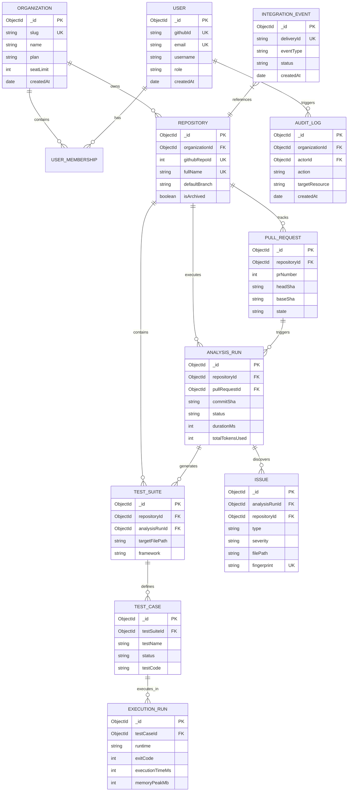

# DevFlow AI — Database Schema Specification

This document provides the definitive data architecture for DevFlow AI using **MongoDB 7.0+** and **Mongoose 8.x**. It details the entity relationships, complete TypeScript interfaces, Mongoose schema definitions, compound and unique indexing strategies, schema versioning, and soft-delete/lifecycle policies.

---

## 1. Entity-Relationship Overview (Mermaid ERD)



---

## 2. Global Conventions & Standards

1. **Identifiers**: All primary keys are standard MongoDB 12-byte `ObjectId`s named `_id`. Foreign keys reference related documents using typed `mongoose.Types.ObjectId`.
2. **Timestamps**: Every collection includes standard `createdAt: Date` and `updatedAt: Date` managed automatically by Mongoose `{ timestamps: true }`.
3. **Soft Deletion**: Sensitive entities (`Organization`, `User`, `Repository`) implement soft deletion via `deletedAt: Date | null` (indexed) and `isDeleted: boolean`.
4. **Schema Versioning**: Collections incorporate a `__v` schema version tag and an explicit `schemaVersion: number` field to support zero-downtime lazy document migrations.
5. **String Trimming & Invariant Constraints**: String identifiers, emails, repository names, and slugs are normalized to lowercase and trimmed at schema level.

---

## 3. Collections & TypeScript Schema Specifications

### 3.1. `users` Collection

Stores authenticated developers, administrators, and their associated GitHub identity details.

```typescript
import { Schema, model, Document, Types } from 'mongoose';

export type UserRole = 'SYSTEM_ADMIN' | 'USER';

export interface IUser extends Document {
  _id: Types.ObjectId;
  githubId: number;
  username: string;
  email: string;
  displayName: string;
  avatarUrl: string;
  role: UserRole;
  accessTokenEncrypted: string;
  refreshTokenEncrypted?: string;
  lastLoginAt: Date;
  isDeleted: boolean;
  deletedAt?: Date;
  schemaVersion: number;
  createdAt: Date;
  updatedAt: Date;
}

export const UserSchema = new Schema<IUser>(
  {
    githubId: { type: Number, required: true, unique: true, index: true },
    username: { type: String, required: true, trim: true, lowercase: true, index: true },
    email: { type: String, required: true, trim: true, lowercase: true, unique: true, index: true },
    displayName: { type: String, required: true, trim: true },
    avatarUrl: { type: String, required: true },
    role: { type: String, enum: ['SYSTEM_ADMIN', 'USER'], default: 'USER', required: true },
    accessTokenEncrypted: { type: String, required: true },
    refreshTokenEncrypted: { type: String, default: null },
    lastLoginAt: { type: Date, default: Date.now },
    isDeleted: { type: Boolean, default: false, index: true },
    deletedAt: { type: Date, default: null },
    schemaVersion: { type: Number, default: 1, required: true }
  },
  { timestamps: true }
);

// Indexes
UserSchema.index({ email: 1, isDeleted: 1 });
UserSchema.index({ username: 1, isDeleted: 1 });
```

---

### 3.2. `organizations` Collection

Represents the multi-tenant organizational boundary with subscription limits and settings.

```typescript
export type OrgPlan = 'FREE' | 'STARTER' | 'PRO' | 'ENTERPRISE';

export interface IOrganizationLimits {
  maxRepositories: number;
  maxMonthlyScans: number;
  maxConcurrentSandboxes: number;
  customRulesAllowed: boolean;
}

export interface IOrganization extends Document {
  _id: Types.ObjectId;
  name: string;
  slug: string;
  githubOrgId?: number;
  installationId?: number;
  plan: OrgPlan;
  limits: IOrganizationLimits;
  billingEmail: string;
  stripeCustomerId?: string;
  isDeleted: boolean;
  deletedAt?: Date;
  schemaVersion: number;
  createdAt: Date;
  updatedAt: Date;
}

export const OrganizationSchema = new Schema<IOrganization>(
  {
    name: { type: String, required: true, trim: true },
    slug: { type: String, required: true, unique: true, lowercase: true, trim: true, index: true },
    githubOrgId: { type: Number, default: null, sparse: true, index: true },
    installationId: { type: Number, default: null, sparse: true, index: true },
    plan: { type: String, enum: ['FREE', 'STARTER', 'PRO', 'ENTERPRISE'], default: 'FREE', required: true },
    limits: {
      maxRepositories: { type: Number, default: 5 },
      maxMonthlyScans: { type: Number, default: 100 },
      maxConcurrentSandboxes: { type: Number, default: 2 },
      customRulesAllowed: { type: Boolean, default: false }
    },
    billingEmail: { type: String, required: true, lowercase: true, trim: true },
    stripeCustomerId: { type: String, default: null },
    isDeleted: { type: Boolean, default: false, index: true },
    deletedAt: { type: Date, default: null },
    schemaVersion: { type: Number, default: 1, required: true }
  },
  { timestamps: true }
);
```

---

### 3.3. `user_memberships` Collection

Implements many-to-many relationship between Users and Organizations with granular RBAC permissions.

```typescript
export type MembershipRole = 'OWNER' | 'ADMIN' | 'MEMBER' | 'VIEWER';

export interface IUserMembership extends Document {
  _id: Types.ObjectId;
  userId: Types.ObjectId;
  organizationId: Types.ObjectId;
  role: MembershipRole;
  invitedBy?: Types.ObjectId;
  joinedAt: Date;
  schemaVersion: number;
  createdAt: Date;
  updatedAt: Date;
}

export const UserMembershipSchema = new Schema<IUserMembership>(
  {
    userId: { type: Schema.Types.ObjectId, ref: 'User', required: true, index: true },
    organizationId: { type: Schema.Types.ObjectId, ref: 'Organization', required: true, index: true },
    role: { type: String, enum: ['OWNER', 'ADMIN', 'MEMBER', 'VIEWER'], default: 'MEMBER', required: true },
    invitedBy: { type: Schema.Types.ObjectId, ref: 'User', default: null },
    joinedAt: { type: Date, default: Date.now },
    schemaVersion: { type: Number, default: 1, required: true }
  },
  { timestamps: true }
);

// Compound Unique Index: One membership per user per organization
UserMembershipSchema.index({ organizationId: 1, userId: 1 }, { unique: true });
UserMembershipSchema.index({ organizationId: 1, role: 1 });
```

---

### 3.4. `repositories` Collection

Maintains synchronized GitHub repositories tracked by DevFlow AI.

```typescript
export interface IRepoLanguageBreakdown {
  language: string;
  byteCount: number;
  percentage: number;
}

export interface IScanSettings {
  autoReviewPullRequests: boolean;
  failCheckOnHighSeverity: boolean;
  generateTestsAutomatically: boolean;
  targetTestFramework: 'jest' | 'vitest' | 'pytest';
  ignoredPaths: string[];
  maxFileSizeKb: number;
}

export interface IRepository extends Document {
  _id: Types.ObjectId;
  organizationId: Types.ObjectId;
  githubRepoId: number;
  name: string;
  fullName: string; // e.g. "octocat/hello-world"
  isPrivate: boolean;
  htmlUrl: string;
  defaultBranch: string;
  installationId: number;
  languages: IRepoLanguageBreakdown[];
  primaryLanguage: string;
  scanSettings: IScanSettings;
  lastScannedAt?: Date;
  healthScore: number; // 0 - 100
  isArchived: boolean;
  isDeleted: boolean;
  deletedAt?: Date;
  schemaVersion: number;
  createdAt: Date;
  updatedAt: Date;
}

export const RepositorySchema = new Schema<IRepository>(
  {
    organizationId: { type: Schema.Types.ObjectId, ref: 'Organization', required: true, index: true },
    githubRepoId: { type: Number, required: true, unique: true, index: true },
    name: { type: String, required: true, trim: true },
    fullName: { type: String, required: true, unique: true, trim: true, index: true },
    isPrivate: { type: Boolean, required: true },
    htmlUrl: { type: String, required: true },
    defaultBranch: { type: String, default: 'main', required: true },
    installationId: { type: Number, required: true, index: true },
    languages: [
      {
        language: { type: String, required: true },
        byteCount: { type: Number, required: true },
        percentage: { type: Number, required: true }
      }
    ],
    primaryLanguage: { type: String, default: 'Unknown' },
    scanSettings: {
      autoReviewPullRequests: { type: Boolean, default: true },
      failCheckOnHighSeverity: { type: Boolean, default: true },
      generateTestsAutomatically: { type: Boolean, default: false },
      targetTestFramework: { type: String, enum: ['jest', 'vitest', 'pytest'], default: 'vitest' },
      ignoredPaths: { type: [String], default: ['**/node_modules/**', '**/dist/**', '**/*.min.js'] },
      maxFileSizeKb: { type: Number, default: 500 }
    },
    lastScannedAt: { type: Date, default: null },
    healthScore: { type: Number, default: 100, min: 0, max: 100 },
    isArchived: { type: Boolean, default: false },
    isDeleted: { type: Boolean, default: false, index: true },
    deletedAt: { type: Date, default: null },
    schemaVersion: { type: Number, default: 1, required: true }
  },
  { timestamps: true }
);

// Compound Index: Retrieve active repos for an organization quickly
RepositorySchema.index({ organizationId: 1, isDeleted: 1, fullName: 1 });
```

---

### 3.5. `pull_requests` Collection

Tracks individual PR lifecycles, branch references, and synchronizations.

```typescript
export type PRState = 'OPEN' | 'CLOSED' | 'MERGED';

export interface IPullRequest extends Document {
  _id: Types.ObjectId;
  repositoryId: Types.ObjectId;
  prNumber: number;
  githubPrId: number;
  title: string;
  headSha: string;
  baseSha: string;
  headBranch: string;
  baseBranch: string;
  state: PRState;
  authorUsername: string;
  authorAvatarUrl: string;
  changedFilesCount: number;
  additions: number;
  deletions: number;
  latestAnalysisRunId?: Types.ObjectId;
  mergedAt?: Date;
  closedAt?: Date;
  schemaVersion: number;
  createdAt: Date;
  updatedAt: Date;
}

export const PullRequestSchema = new Schema<IPullRequest>(
  {
    repositoryId: { type: Schema.Types.ObjectId, ref: 'Repository', required: true, index: true },
    prNumber: { type: Number, required: true },
    githubPrId: { type: Number, required: true, index: true },
    title: { type: String, required: true },
    headSha: { type: String, required: true },
    baseSha: { type: String, required: true },
    headBranch: { type: String, required: true },
    baseBranch: { type: String, required: true },
    state: { type: String, enum: ['OPEN', 'CLOSED', 'MERGED'], default: 'OPEN', required: true },
    authorUsername: { type: String, required: true },
    authorAvatarUrl: { type: String, required: true },
    changedFilesCount: { type: Number, default: 0 },
    additions: { type: Number, default: 0 },
    deletions: { type: Number, default: 0 },
    latestAnalysisRunId: { type: Schema.Types.ObjectId, ref: 'AnalysisRun', default: null },
    mergedAt: { type: Date, default: null },
    closedAt: { type: Date, default: null },
    schemaVersion: { type: Number, default: 1, required: true }
  },
  { timestamps: true }
);

// Compound Unique Index: One entry per PR per repository
PullRequestSchema.index({ repositoryId: 1, prNumber: 1 }, { unique: true });
PullRequestSchema.index({ repositoryId: 1, state: 1 });
```

---

### 3.6. `analysis_runs` Collection

Represents an execution instance of a codebase audit, PR review, or vulnerability scan.

```typescript
export type AnalysisTrigger = 'WEBHOOK_PR' | 'WEBHOOK_PUSH' | 'MANUAL_UI' | 'API_TRIGGER';
export type AnalysisStatus = 'QUEUED' | 'RUNNING' | 'COMPLETED' | 'FAILED' | 'CANCELLED';

export interface IAnalysisMetrics {
  bugsFound: number;
  vulnerabilitiesFound: number;
  codeSmellsFound: number;
  securityCriticalCount: number;
  qualityScore: number;
  cyclomaticComplexityAvg: number;
  cognitiveComplexityAvg: number;
}

export interface ITokenUsage {
  promptTokens: number;
  completionTokens: number;
  totalTokens: number;
  estimatedCostUsd: number;
}

export interface IAnalysisRun extends Document {
  _id: Types.ObjectId;
  repositoryId: Types.ObjectId;
  pullRequestId?: Types.ObjectId;
  trigger: AnalysisTrigger;
  status: AnalysisStatus;
  commitSha: string;
  branch: string;
  githubCheckRunId?: number;
  metrics: IAnalysisMetrics;
  tokenUsage: ITokenUsage;
  startedAt?: Date;
  completedAt?: Date;
  durationMs: number;
  errorMessage?: string;
  schemaVersion: number;
  createdAt: Date;
  updatedAt: Date;
}

export const AnalysisRunSchema = new Schema<IAnalysisRun>(
  {
    repositoryId: { type: Schema.Types.ObjectId, ref: 'Repository', required: true, index: true },
    pullRequestId: { type: Schema.Types.ObjectId, ref: 'PullRequest', default: null, index: true },
    trigger: {
      type: String,
      enum: ['WEBHOOK_PR', 'WEBHOOK_PUSH', 'MANUAL_UI', 'API_TRIGGER'],
      required: true
    },
    status: {
      type: String,
      enum: ['QUEUED', 'RUNNING', 'COMPLETED', 'FAILED', 'CANCELLED'],
      default: 'QUEUED',
      required: true,
      index: true
    },
    commitSha: { type: String, required: true, index: true },
    branch: { type: String, required: true },
    githubCheckRunId: { type: Number, default: null, sparse: true },
    metrics: {
      bugsFound: { type: Number, default: 0 },
      vulnerabilitiesFound: { type: Number, default: 0 },
      codeSmellsFound: { type: Number, default: 0 },
      securityCriticalCount: { type: Number, default: 0 },
      qualityScore: { type: Number, default: 100 },
      cyclomaticComplexityAvg: { type: Number, default: 0 },
      cognitiveComplexityAvg: { type: Number, default: 0 }
    },
    tokenUsage: {
      promptTokens: { type: Number, default: 0 },
      completionTokens: { type: Number, default: 0 },
      totalTokens: { type: Number, default: 0 },
      estimatedCostUsd: { type: Number, default: 0 }
    },
    startedAt: { type: Date, default: null },
    completedAt: { type: Date, default: null },
    durationMs: { type: Number, default: 0 },
    errorMessage: { type: String, default: null },
    schemaVersion: { type: Number, default: 1, required: true }
  },
  { timestamps: true }
);

// Indexes
AnalysisRunSchema.index({ repositoryId: 1, createdAt: -1 });
AnalysisRunSchema.index({ repositoryId: 1, commitSha: 1 });
AnalysisRunSchema.index({ status: 1, createdAt: 1 });
```

---

### 3.7. `issues` (Findings & Vulnerabilities) Collection

Granular issues, bugs, and security findings identified by the AI analysis engine.

```typescript
export type IssueType = 'SECURITY_VULNERABILITY' | 'BUG' | 'CODE_SMELL' | 'PERFORMANCE_ISSUE';
export type IssueSeverity = 'CRITICAL' | 'HIGH' | 'MEDIUM' | 'LOW' | 'INFO';
export type IssueStatus = 'OPEN' | 'RESOLVED' | 'FALSE_POSITIVE' | 'IGNORED';

export interface ICodeLocation {
  filePath: string;
  startLine: number;
  endLine: number;
  startColumn?: number;
  endColumn?: number;
  snippet: string;
}

export interface IIssue extends Document {
  _id: Types.ObjectId;
  analysisRunId: Types.ObjectId;
  repositoryId: Types.ObjectId;
  pullRequestId?: Types.ObjectId;
  type: IssueType;
  severity: IssueSeverity;
  status: IssueStatus;
  title: string;
  description: string;
  location: ICodeLocation;
  cweId?: string; // e.g. "CWE-89" (SQL Injection)
  owaspCategory?: string; // e.g. "A03:2021-Injection"
  suggestedFixDiff?: string;
  suggestedFixExplanation?: string;
  fingerprint: string; // SHA-256(filePath + ruleId + astSignature) to detect recurring issues
  githubCommentId?: number;
  resolvedAt?: Date;
  resolvedBy?: Types.ObjectId;
  schemaVersion: number;
  createdAt: Date;
  updatedAt: Date;
}

export const IssueSchema = new Schema<IIssue>(
  {
    analysisRunId: { type: Schema.Types.ObjectId, ref: 'AnalysisRun', required: true, index: true },
    repositoryId: { type: Schema.Types.ObjectId, ref: 'Repository', required: true, index: true },
    pullRequestId: { type: Schema.Types.ObjectId, ref: 'PullRequest', default: null, index: true },
    type: {
      type: String,
      enum: ['SECURITY_VULNERABILITY', 'BUG', 'CODE_SMELL', 'PERFORMANCE_ISSUE'],
      required: true,
      index: true
    },
    severity: {
      type: String,
      enum: ['CRITICAL', 'HIGH', 'MEDIUM', 'LOW', 'INFO'],
      required: true,
      index: true
    },
    status: {
      type: String,
      enum: ['OPEN', 'RESOLVED', 'FALSE_POSITIVE', 'IGNORED'],
      default: 'OPEN',
      required: true,
      index: true
    },
    title: { type: String, required: true, trim: true },
    description: { type: String, required: true },
    location: {
      filePath: { type: String, required: true, index: true },
      startLine: { type: Number, required: true },
      endLine: { type: Number, required: true },
      startColumn: { type: Number, default: 1 },
      endColumn: { type: Number, default: 1 },
      snippet: { type: String, required: true }
    },
    cweId: { type: String, default: null },
    owaspCategory: { type: String, default: null },
    suggestedFixDiff: { type: String, default: null },
    suggestedFixExplanation: { type: String, default: null },
    fingerprint: { type: String, required: true, index: true },
    githubCommentId: { type: Number, default: null },
    resolvedAt: { type: Date, default: null },
    resolvedBy: { type: Schema.Types.ObjectId, ref: 'User', default: null },
    schemaVersion: { type: Number, default: 1, required: true }
  },
  { timestamps: true }
);

// Compound Indexes: Searching active vulnerabilities per repo
IssueSchema.index({ repositoryId: 1, status: 1, severity: 1 });
IssueSchema.index({ repositoryId: 1, fingerprint: 1, status: 1 });
```

---

### 3.8. `test_suites` & `test_cases` Collections

Manages AI-synthesized unit test structures and their underlying test case specifications.

```typescript
export type TestFramework = 'pytest' | 'jest' | 'vitest';
export type TestCaseStatus = 'GENERATED' | 'EXECUTING' | 'PASSED' | 'FAILED' | 'SYNTAX_ERROR';

export interface ITestSuite extends Document {
  _id: Types.ObjectId;
  repositoryId: Types.ObjectId;
  analysisRunId?: Types.ObjectId;
  targetFilePath: string;
  framework: TestFramework;
  totalCases: number;
  passedCases: number;
  coverageEstimatePercent?: number;
  schemaVersion: number;
  createdAt: Date;
  updatedAt: Date;
}

export const TestSuiteSchema = new Schema<ITestSuite>(
  {
    repositoryId: { type: Schema.Types.ObjectId, ref: 'Repository', required: true, index: true },
    analysisRunId: { type: Schema.Types.ObjectId, ref: 'AnalysisRun', default: null, index: true },
    targetFilePath: { type: String, required: true, index: true },
    framework: { type: String, enum: ['pytest', 'jest', 'vitest'], required: true },
    totalCases: { type: Number, default: 0 },
    passedCases: { type: Number, default: 0 },
    coverageEstimatePercent: { type: Number, default: 0 },
    schemaVersion: { type: Number, default: 1, required: true }
  },
  { timestamps: true }
);

export interface ITestCase extends Document {
  _id: Types.ObjectId;
  testSuiteId: Types.ObjectId;
  testName: string;
  targetFunctionName: string;
  description: string;
  testCode: string;
  status: TestCaseStatus;
  retryAttempts: number;
  lastExecutionRunId?: Types.ObjectId;
  schemaVersion: number;
  createdAt: Date;
  updatedAt: Date;
}

export const TestCaseSchema = new Schema<ITestCase>(
  {
    testSuiteId: { type: Schema.Types.ObjectId, ref: 'TestSuite', required: true, index: true },
    testName: { type: String, required: true, trim: true },
    targetFunctionName: { type: String, required: true, trim: true },
    description: { type: String, required: true },
    testCode: { type: String, required: true },
    status: {
      type: String,
      enum: ['GENERATED', 'EXECUTING', 'PASSED', 'FAILED', 'SYNTAX_ERROR'],
      default: 'GENERATED',
      required: true,
      index: true
    },
    retryAttempts: { type: Number, default: 0 },
    lastExecutionRunId: { type: Schema.Types.ObjectId, ref: 'ExecutionRun', default: null },
    schemaVersion: { type: Number, default: 1, required: true }
  },
  { timestamps: true }
);

// Indexes
TestCaseSchema.index({ testSuiteId: 1, status: 1 });
```

---

### 3.9. `execution_runs` Collection

Audits sandbox runtime execution metrics and output streams for each test execution.

```typescript
export type SandboxRuntime = 'python:3.11' | 'node:20';

export interface IExecutionRun extends Document {
  _id: Types.ObjectId;
  testCaseId: Types.ObjectId;
  runtime: SandboxRuntime;
  exitCode: number;
  stdout: string;
  stderr: string;
  executionTimeMs: number;
  memoryPeakMb: number;
  isTimedOut: boolean;
  isOomKilled: boolean;
  containerId: string;
  schemaVersion: number;
  createdAt: Date;
}

export const ExecutionRunSchema = new Schema<IExecutionRun>(
  {
    testCaseId: { type: Schema.Types.ObjectId, ref: 'TestCase', required: true, index: true },
    runtime: { type: String, enum: ['python:3.11', 'node:20'], required: true },
    exitCode: { type: Number, required: true },
    stdout: { type: String, default: '' },
    stderr: { type: String, default: '' },
    executionTimeMs: { type: Number, required: true },
    memoryPeakMb: { type: Number, required: true },
    isTimedOut: { type: Boolean, default: false },
    isOomKilled: { type: Boolean, default: false },
    containerId: { type: String, required: true },
    schemaVersion: { type: Number, default: 1, required: true }
  },
  { timestamps: true }
);

// TTL Index: Auto-expire sandbox execution stdout/stderr logs after 30 days
ExecutionRunSchema.index({ createdAt: 1 }, { expireAfterSeconds: 2592000 });
```

---

### 3.10. `audit_logs` Collection

Maintains an immutable compliance log of administrative actions, role modifications, and repository settings updates.

```typescript
export interface IAuditLog extends Document {
  _id: Types.ObjectId;
  organizationId: Types.ObjectId;
  actorId: Types.ObjectId;
  actorEmail: string;
  action: string; // e.g. "REPO_SETTINGS_UPDATE", "RULE_MUTATION", "ROLE_CHANGE"
  targetResource: string;
  resourceId: string;
  ipAddress: string;
  userAgent: string;
  diffPayload?: Record<string, unknown>;
  createdAt: Date;
}

export const AuditLogSchema = new Schema<IAuditLog>(
  {
    organizationId: { type: Schema.Types.ObjectId, ref: 'Organization', required: true, index: true },
    actorId: { type: Schema.Types.ObjectId, ref: 'User', required: true, index: true },
    actorEmail: { type: String, required: true },
    action: { type: String, required: true, index: true },
    targetResource: { type: String, required: true },
    resourceId: { type: String, required: true },
    ipAddress: { type: String, required: true },
    userAgent: { type: String, required: true },
    diffPayload: { type: Schema.Types.Mixed, default: null }
  },
  { timestamps: { createdAt: true, updatedAt: false } }
);

// TTL Index: Retain compliance audit trail for 1 year (365 days)
AuditLogSchema.index({ createdAt: 1 }, { expireAfterSeconds: 31536000 });
AuditLogSchema.index({ organizationId: 1, createdAt: -1 });
```

---

### 3.11. `integration_events` (Webhook Idempotency) Collection

Guarantees exactly-once processing of incoming GitHub webhook payloads and prevents replay attacks.

```typescript
export type EventProcessingStatus = 'RECEIVED' | 'PROCESSING' | 'COMPLETED' | 'FAILED' | 'IGNORED';

export interface IIntegrationEvent extends Document {
  _id: Types.ObjectId;
  deliveryId: string; // GitHub X-GitHub-Delivery GUID
  eventType: string; // "pull_request", "push", "installation"
  repositoryId?: Types.ObjectId;
  githubRepoId?: number;
  payloadHash: string; // SHA-256 hash of payload
  status: EventProcessingStatus;
  errorMessage?: string;
  createdAt: Date;
  updatedAt: Date;
}

export const IntegrationEventSchema = new Schema<IIntegrationEvent>(
  {
    deliveryId: { type: String, required: true, unique: true, index: true },
    eventType: { type: String, required: true, index: true },
    repositoryId: { type: Schema.Types.ObjectId, ref: 'Repository', default: null },
    githubRepoId: { type: Number, default: null },
    payloadHash: { type: String, required: true },
    status: {
      type: String,
      enum: ['RECEIVED', 'PROCESSING', 'COMPLETED', 'FAILED', 'IGNORED'],
      default: 'RECEIVED',
      required: true
    },
    errorMessage: { type: String, default: null }
  },
  { timestamps: true }
);

// TTL Index: Auto-prune processed webhook idempotency records after 7 days
IntegrationEventSchema.index({ createdAt: 1 }, { expireAfterSeconds: 604800 });
```

---

## 4. Indexing & Query Optimization Strategy Summary

| Collection | Index Key | Index Type | Primary Query Profile |
| :--- | :--- | :--- | :--- |
| `users` | `{ email: 1, isDeleted: 1 }` | Compound | Fast user lookup on OAuth login |
| `organizations` | `{ slug: 1 }` | Unique | Org lookup via route slug |
| `user_memberships` | `{ organizationId: 1, userId: 1 }` | Compound Unique | RBAC authorization validation |
| `repositories` | `{ organizationId: 1, isDeleted: 1, fullName: 1 }` | Compound | Dashboard repository list |
| `pull_requests` | `{ repositoryId: 1, prNumber: 1 }` | Compound Unique | Webhook PR lookup & deduplication |
| `analysis_runs` | `{ repositoryId: 1, createdAt: -1 }` | Compound | Scan history timeline |
| `issues` | `{ repositoryId: 1, status: 1, severity: 1 }` | Compound | Vulnerability triaging queries |
| `issues` | `{ repositoryId: 1, fingerprint: 1, status: 1 }`| Compound | Recurring bug regression tracking |
| `execution_runs` | `{ createdAt: 1 } (expireAfter: 30d)` | TTL | Automatic log hygiene |
| `integration_events`| `{ deliveryId: 1 }` | Unique | Immediate duplicate webhook rejection |
