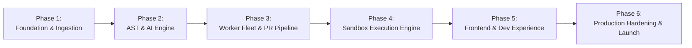

# DevFlow AI — Engineering Development Roadmap

This document outlines the end-to-end phased development lifecycle, milestones, deliverables, test criteria, and production exit gates for **DevFlow AI**.

---

## Roadmap Phases Overview

---

## Phase 1: Core Foundation & Infrastructure Orchestration

**Objective**: Establish the monorepo architecture, foundational data stores, GitHub App integration handshake, and authentication primitives.

### Deliverables & Milestones
- [x] Monorepo scaffold (`pnpm` workspaces for `apps/web`, `apps/api`, `services/ai`, `workers/job-processor`, `workers/execution-engine`, `packages/shared`).
- [x] Docker Compose environment containing MongoDB 7.0 (Replica Set mode) and Redis 7.2 Stack.
- [x] Shared TypeScript package (`@devflow/shared`) housing universal Zod validation schemas and DTOs.
- [ ] Core API server initialization (Express, TypeScript, Winston JSON logging, RFC 7807 error middleware).
- [ ] Mongoose schema implementations with compound indices, timestamps, and soft-delete support (`users`, `organizations`, `repositories`, `pull_requests`).
- [ ] GitHub App integration setup:
  - Webhook endpoint (`/api/v1/webhooks/github`) with HMAC-SHA256 constant-time verification.
  - GitHub OAuth 2.0 PKCE authentication flow and JWT access/refresh token cycle.
  - Octokit installation client factory with dynamic token refresh.

### Exit Criteria & Quality Gates
- 100% pass rate on unit tests for Webhook HMAC verification and token signing.
- Zero credential leakage in git history (verified via `git-secrets` / Gitleaks).
- MongoDB replica set election verified in local Docker Compose.

---

## Phase 2: Python AI Service & AST Parsing Engine

**Objective**: Build the dedicated Python AI microservice for AST parsing, token-budgeted prompt construction, and deterministic LLM structured inference.

### Deliverables & Milestones
- [ ] FastAPI service setup with async ASGI lifecycle and Loguru structured JSON logging.
- [ ] Tree-sitter AST engine supporting:
  - Python (`tree-sitter-python`)
  - JavaScript (`tree-sitter-javascript`)
  - TypeScript (`tree-sitter-typescript`)
- [ ] Code metrics extraction: Function symbol mapping, cyclomatic complexity calculation, cognitive load score.
- [ ] Intelligent chunking and token budgeter (using `tiktoken` / token estimators) with sliding context window over git diffs.
- [ ] LLM Client Gateway:
  - Primary provider: Anthropic Claude 3.5 Sonnet.
  - Secondary provider: OpenAI GPT-4o.
  - Exponential backoff retry logic and circuit-breaker fallback.
- [ ] Pydantic v2 structured output validation for vulnerability and code review schemas.
- [ ] Post-generation Hallucination Filter: AST cross-check to guarantee reported lines and identifiers exist.

### Exit Criteria & Quality Gates
- Pydantic validation rejects 100% of non-conforming LLM payloads.
- AST parsing benchmark: Parse 1,000 files in under 3.5 seconds.
- Sub-second roundtrip for AST complexity evaluation.

---

## Phase 3: Background Worker Fleet & PR Review Pipeline

**Objective**: Implement asynchronous BullMQ worker queues to process GitHub webhooks, download code diffs, run AI evaluations, and post reviews to GitHub.

### Deliverables & Milestones
- [ ] BullMQ queue topology and worker initialization:
  - `webhook-ingestion-queue`
  - `repository-scan-queue`
  - `pr-review-queue`
- [ ] Pull Request synchronization flow:
  - Handle `pull_request.opened` and `pull_request.synchronize`.
  - Fetch file diffs via Octokit REST API.
  - Atomic deduplication using Redis Redlock (`lock:pr_review:${repoId}:${prNumber}:${headSha}`).
- [ ] GitHub Check Run integration:
  - Create Check Run in `in_progress` state upon webhook arrival.
  - Update Check Run conclusion (`success`, `neutral`, `failure`) based on findings.
- [ ] Automated Pull Request Comments:
  - Post line-level comments on modified diff lines.
  - Post comprehensive Markdown review summary with quality score and vulnerability counts.
- [ ] Dead-letter queue (DLQ) alert handlers and retry backoff.

### Exit Criteria & Quality Gates
- End-to-end PR review completion in < 45 seconds for diffs under 500 lines.
- Zero duplicate reviews when multiple commits are pushed in rapid succession.
- Automatic DLQ alerting on unrecoverable failures.

---

## Phase 4: Sandboxed Code Execution Engine

**Objective**: Engineer the Docker/gVisor isolated execution environment to generate and safely execute unit test suites.

### Deliverables & Milestones
- [ ] Docker sandbox base images:
  - `devflow-sandbox-python`: Alpine/Debian minimal with Python 3.11, `pytest`, `coverage`.
  - `devflow-sandbox-node`: Alpine minimal with Node.js 20, `jest`, `vitest`.
- [ ] Dockerode sandbox driver:
  - Non-root execution (`10001:10001`), `--network none`, `--read-only`, 64MB memory `tmpfs`.
  - cgroups v2 resource quotas (512MB RAM, 1.0 vCPU, 64 PIDs max).
  - Whitelisted Seccomp profile blocking dangerous syscalls.
- [ ] Out-of-band timeout watchdog (SIGTERM at 15s, SIGKILL at 20s).
- [ ] AI Test Generation Loop:
  - Prompt orchestrator requests targeted unit tests for given function AST.
  - Sandbox runs generated tests against source code.
  - If tests fail, feed stderr back into AI for self-correction (max 2 retries).
  - Persist verified test suites and execution logs.

### Exit Criteria & Quality Gates
- Security validation: Sandbox successfully blocks fork bombs, network calls, and filesystem write attempts outside `/tmp`.
- Memory threshold tests confirm OOM termination without impacting host worker.
- Container cleanup guarantee: 0 orphaned containers after 100 consecutive runs.

---

## Phase 5: Modern Frontend Web Application & Real-Time Experience

**Objective**: Build a high-performance React application delivering intuitive repository browsing, code review diff exploration, and live execution consoles.

### Deliverables & Milestones
- [ ] Frontend setup: Vite + React 18 + TypeScript + Tailwind CSS + shadcn/ui.
- [ ] TanStack Query state architecture with optimistic updates and caching.
- [ ] Feature modules:
  - **Auth & Onboarding**: GitHub OAuth login, workspace selector.
  - **Repository Dashboard**: Monitored repos, health scores, language charts, scan histories.
  - **Pull Request Review View**: Interactive diff viewer with inline vulnerability markers and code fix suggestions.
  - **Test Generation Studio**: Function picker, framework selector (`pytest`, `vitest`, `jest`), and live execution terminal.
  - **Vulnerability Triaging**: Filtering by severity (Critical, High, Medium, Low), CWE categorization, and false-positive marking.
- [ ] Server-Sent Events (SSE) integration for real-time scan progress and container execution streaming.

### Exit Criteria & Quality Gates
- Lighthouse Performance score > 90.
- Sub-100ms UI response time for repository navigation.
- Accessible UI components compliant with WCAG 2.1 AA (Radix primitives).

---

## Phase 6: Production Hardening, Observability & Cloud Deployment

**Objective**: Prepare DevFlow AI for high-availability enterprise deployment, continuous observability, and SOC 2 / ISO 27001 readiness.

### Deliverables & Milestones
- [ ] Production multi-stage Dockerfiles for all microservices.
- [ ] Cloud Deployment Architecture:
  - Frontend: Deployed on Vercel Edge Network.
  - Core API & Python AI: Deployed on AWS ECS Fargate or Kubernetes (EKS).
  - Database: MongoDB Atlas (Replica Set with automated backups).
  - Cache & Queues: AWS ElastiCache for Redis (Multi-AZ).
- [ ] CI/CD GitHub Actions:
  - Automated linting (ESLint, Ruff), static type checking (tsc, Mypy), and unit tests.
  - Container vulnerability scanning with Trivy.
- [ ] Telemetry & Observability:
  - Prometheus `/metrics` endpoints across Node.js and FastAPI services.
  - Distributed request tracing with OpenTelemetry and `X-Correlation-ID`.
  - Winston/Loguru log forwarding to Datadog or Grafana Loki.
- [ ] Disaster recovery & backup runbooks.

### Exit Criteria & Quality Gates
- 99.9% uptime SLA capability with zero-downtime rolling deployments.
- Chaos testing: Queue worker recovers cleanly upon sudden Redis node failover.
- Clean container vulnerability audit (0 Critical / 0 High CVEs).
